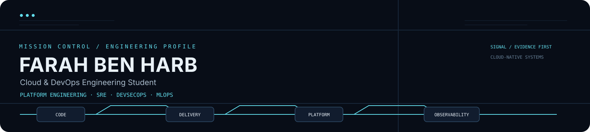
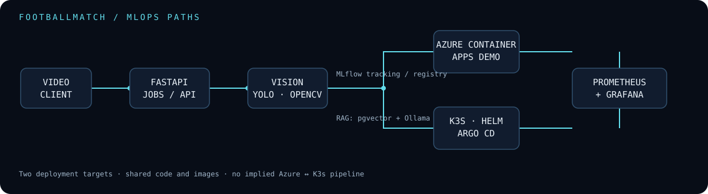
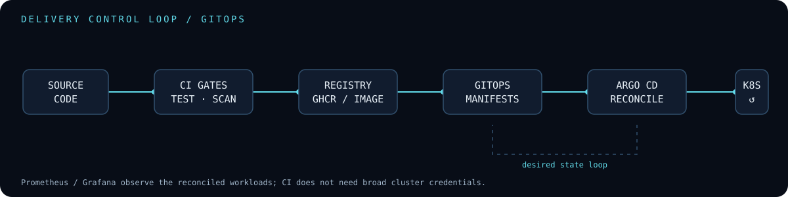
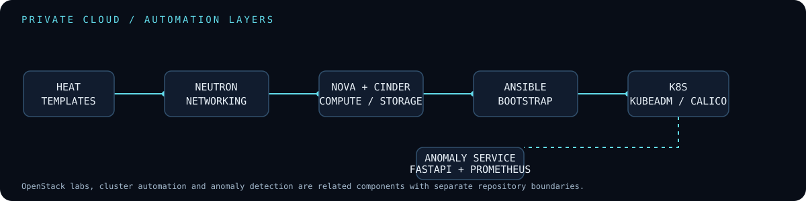
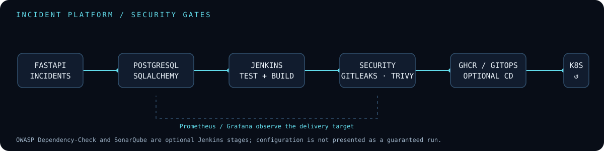

  

  <a href="https://github.com/farah-ben-harb">GitHub</a> ·
  <a href="https://www.linkedin.com/in/farah-ben-harb-b26845313/">LinkedIn</a> ·
  <a href="https://farah-me.vercel.app/">Portfolio</a> ·
  <a href="mailto:benharbfarah85@gmail.com">Email</a>

# Farah Ben Harb

**Cloud & DevOps Engineer in training** 
Platform Engineering · SRE · DevSecOps 
MLOps & AI Platform

I am a final-year computer engineering student building reproducible infrastructure, secure delivery workflows and observable platforms. My work connects cloud foundations, Kubernetes/GitOps, reliability practices and applied ML — with an emphasis on documenting what is implemented, what is validated, and what remains a lab or work in progress.

> **Mission control note** — This profile is a curated view of public engineering work. It intentionally avoids inflated metrics, decorative streaks and claims that cannot be traced to code, workflows or documented validation.

## Selected engineering projects

| Project | What it demonstrates |
| --- | --- |
| [FootballMatch AI Platform](https://github.com/farah-ben-harb/footballmatch-ai-platform-mlops) | CPU-first FastAPI video analysis with OpenCV, YOLO11n, ByteTrack and K-Means; MLflow tracking/registry workflow; Docker/Compose; CI security gates; distinct Azure Container Apps and K3s/Helm/Argo CD paths; Prometheus/Grafana. |
| [DevoRecruiter](https://github.com/farah-ben-harb/devorecruiter) · [GitOps](https://github.com/farah-ben-harb/devorecruiter-gitops) | Full-stack multi-service application with Angular, NestJS, FastAPI RAG, PostgreSQL/TypeORM and n8n integration, paired with Helm/Argo CD configuration. Azure/Terraform, Dynatrace and MCP extensions are kept separate when they exist only on work branches. |
| [DevSecOps Incident Platform](https://github.com/farah-ben-harb/devsecops-incident-platform) | FastAPI/PostgreSQL incident API with health/readiness/metrics endpoints, Docker, tests and a Jenkins pipeline defining secret, dependency and container scanning before optional GHCR/GitOps delivery. |
| [GitOps Delivery Platform](https://github.com/farah-ben-harb/gitops-delivery-platform) | Kubernetes manifests, Kustomize overlay, Argo CD application, PostgreSQL persistence, ServiceMonitor and Grafana dashboard for a GitOps delivery path. |
| [Private cloud automation](https://github.com/farah-ben-harb/openstack-heat-infrastructure) · [cluster automation](https://github.com/farah-ben-harb/k8s-cluster-automation) · [Alif manifests](https://github.com/farah-ben-harb/Alif.tn-App-k8s) | Separate OpenStack Heat infrastructure, Ansible/kubeadm cluster automation and Kubernetes workload manifests. These are related lab components, not presented as one freshly re-deployed platform. |
| [Azure IaC & CI/CD](https://github.com/farah-ben-harb/flask-azure-devops-pipeline) | Flask service, Docker packaging, GitHub Actions, Terraform targeting an existing Azure VM extension, and Prometheus/Grafana/Alertmanager observability. |

**Additional MLOps lab:** [Mini CRM Intelligence](https://github.com/farah-ben-harb/crm-intelligence-mlops) — synthetic-profile classification with FastAPI, scikit-learn, MLflow, Docker Compose, GitHub Actions and GHCR. AWS is a learning plan in that repository, not a claimed deployment.

## Engineering systems / architecture showcase

### FootballMatch MLOps pipeline

The video-analysis service and its RAG path are shown with their two documented deployment targets kept distinct: Azure Container Apps for the core demo, and K3s with Helm/Argo CD for the GitOps runtime.

### Kubernetes + GitOps delivery

The delivery boundary is explicit: CI validates and packages; the GitOps repository stores desired state; Argo CD reconciles the cluster; Prometheus and Grafana provide the observability surface.

### OpenStack infrastructure automation

Heat resources, Ansible bootstrap and the complementary anomaly-detection service are represented as separate layers, matching the repositories' actual boundaries.

### DevSecOps incident delivery

This diagram shows the configured Jenkins path and labels optional stages honestly. A pipeline definition is not treated as proof of a live end-to-end deployment.

## Technical focus

### Cloud & infrastructure

Azure · Azure Container Apps · Azure VM extensions · OpenStack Heat · Neutron · Nova · Cinder · Terraform · Ansible · cloud-init · Linux · Bash · networking · IAM and cloud security concepts

### Containers & platform engineering

Docker · Docker Compose · Kubernetes · K3s · kubeadm · containerd · Helm · Kustomize · Argo CD · GitOps · kind · Calico · MetalLB · GHCR · probes/readiness · PVC/local-path

### CI/CD & DevSecOps

GitHub Actions · Jenkins · Git · Gitleaks · Trivy · Semgrep · Bandit · pip-audit · npm audit · Ruff · pytest · container hardening · infrastructure and manifest validation

### Observability & SRE

Prometheus · Grafana · Alertmanager · ServiceMonitor · Dynatrace in professional context · health checks · readiness · logging · metrics · incident diagnosis

### MLOps & AI platform

MLflow Tracking · MLflow Model Registry workflows · FastAPI · Hugging Face tooling · Sentence Transformers · pgvector · RAG · Ollama in the K3s path · YOLO11n · ByteTrack · OpenCV · K-Means · scikit-learn · pandas · NumPy · Isolation Forest · model-serving fundamentals

### Programming & backend

Python · TypeScript · Java · Bash · FastAPI · Flask · NestJS · Angular · PostgreSQL · SQLAlchemy · TypeORM · MySQL · REST APIs · n8n

> Tools are grouped by evidence in public code and project documentation; they are not presented as an equal proficiency ranking.

## Engineering quality / CI & automation

The strongest public evidence is linked directly to the repositories rather than represented by a wall of badges:

- [FootballMatch CI](https://github.com/farah-ben-harb/footballmatch-ai-platform-mlops/actions) — tests, Ruff, Gitleaks, Semgrep, Trivy, Compose validation and controlled image publication.
- [Kubernetes anomaly detection CI](https://github.com/farah-ben-harb/kubernetes-anomaly-detection-openstack/actions) — compilation/tests and container-oriented hardening on the current main line.
- [Mini CRM DevSecOps CI](https://github.com/farah-ben-harb/crm-intelligence-mlops/actions) — tests, training, Ruff, Bandit, Gitleaks, Trivy and GHCR publication; kept as a separate project.
- [DevSecOps Incident Platform Jenkinsfile](https://github.com/farah-ben-harb/devsecops-incident-platform/blob/main/Jenkinsfile) — configured tests, secret/dependency/filesystem/image scans and gated delivery stages.
- [GitOps validation repository](https://github.com/farah-ben-harb/gitops-delivery-platform/actions) — manifest rendering and security-oriented checks where available.

The profile repository itself has a small [deterministic validation workflow](./.github/workflows/profile-integrity.yml) for README links, referenced local assets and SVG safety. It does not call cloud APIs, publish artifacts or generate contribution activity.

## Education & professional context

- **Computer engineering student** — ESPRIT, with an engineering path connected to ESIGELEC and a focus on Cloud and Infrastructure.
- **Devoteam — Cloud & DevOps internship** — professional exposure to Azure, K3s/Kubernetes, GitHub Actions, Helm, Argo CD, Dynatrace and MCP used with Claude Desktop. Personal repositories above remain separate from employer work and do not disclose client details.

## GitHub achievements

Achievements are intentionally kept secondary to engineering evidence. The current profile is reported to include **Pull Shark ×2** and **YOLO**; GitHub does not expose a reliable public API for validating these achievement cards from this repository, so no copied badge assets or invented counters are displayed here.

## Connect

If you are working on cloud platforms, delivery engineering, Kubernetes reliability or MLOps infrastructure, I would be happy to connect.

- [GitHub](https://github.com/farah-ben-harb)
- [LinkedIn](https://www.linkedin.com/in/farah-ben-harb-b26845313/)
- [Portfolio](https://farah-me.vercel.app/)
- [Email](mailto:benharbfarah85@gmail.com)

Profile visual system: Midnight Navy · Deep Blue · Steel Blue · Signal Cyan · Off-White.
